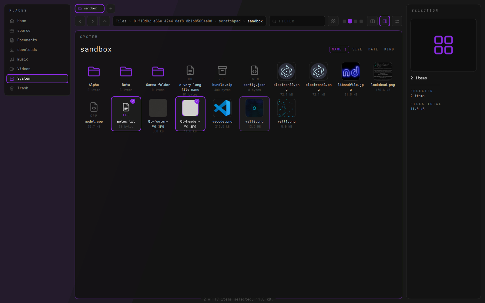

# VAD/OS Files



A file manager for Hyprland, built on VAS: near-black hairline panels, one accent per place, squircle corners, and motion that treats every folder change as a menu transition — the old folder leaves at once, the next one assembles diagonally from the top-left.

## Install

```bash
sudo pacman -S --needed cmake ninja qt6-base qt6-declarative qt6-svg qt6-shadertools udisks2 libarchive
scripts/fetch-fonts.sh        # optional: Space Mono + Audiowide (SIL OFL)
scripts/install.sh            # or: scripts/install.sh --default  to make it open folders everywhere
```

The display face (Wosker / Striker) is not redistributable — drop `Wosker.otf` into `assets/fonts/` and rebuild. Without it the titles fall back to Audiowide, then Mono.

Hyprland: the window's class is `vados-files`, e.g. `bind = $mainMod, E, exec, vados-files`.

## What it does

- **Places, bookmarks, drives.** XDG folders, your GTK bookmarks (shared with every file picker), and removable drives with mount, usage and eject.
- **Each place is a room with its own colour**: Home green, Documents yellow, Downloads blue, Desktop amber, System violet, Trash crimson.
- **Grid and list views**, four tile sizes (Ctrl+wheel or the liquid slider), thumbnails through the shared freedesktop cache.
- **Drag and drop like Windows**: onto folders, places, path segments, tabs and other apps; Ctrl copies, Shift moves, Ctrl+Shift links; hold a drag on a folder and it springs open. A hint next to the pointer says what the drop will do.
- **Rubber-band selection**, Ctrl/Shift click, type-ahead, keyboard navigation everywhere.
- **Copy, move, rename in place, duplicate, new folder/file, compress, extract, trash, restore, delete** — with progress, name-clash prompts (replace / keep both / skip, for all) and undo.
- **Quick look** (Space): the preview grows out of its tile; arrows step through the folder.
- **Tabs**, **split view** (F3), **details column** (Alt+P), filter-as-you-type and deep search, path editing with completion, open with, open terminal here.

## Keys

| Key | Does |
|---|---|
| Enter / double-click | Open |
| Backspace, Alt+↑ | Up |
| Alt+← / Alt+→, mouse back/forward | History |
| F2 | Rename |
| Delete / Shift+Delete | Trash / delete for good (both wait on CONFIRM) |
| Ctrl+C / X / V / D | Copy / cut / paste / duplicate |
| Ctrl+Z | Undo |
| Ctrl+Shift+N | New folder |
| Space | Quick look |
| Ctrl+L | Type a path |
| Ctrl+F | Filter; Enter searches every folder below |
| Ctrl+H | Hidden files |
| Ctrl+1 / Ctrl+2 | Grid / list |
| Ctrl+T / Ctrl+W / Ctrl+Tab | Tabs |
| F3 | Split view |
| Alt+P | Details column |
| Ctrl+Alt+T | Terminal here |
| Ctrl+, | Settings |
